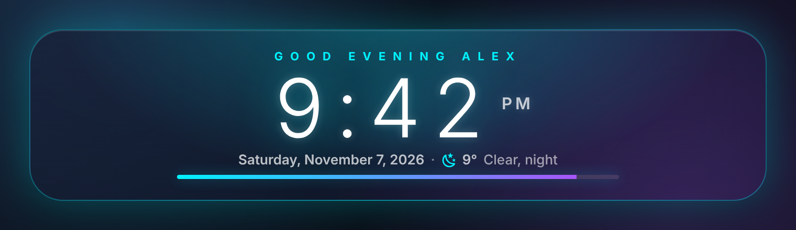
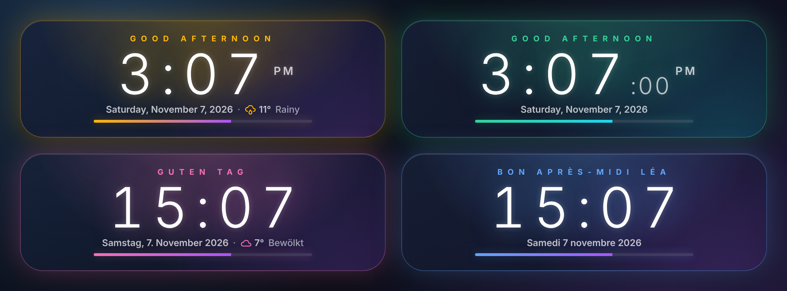
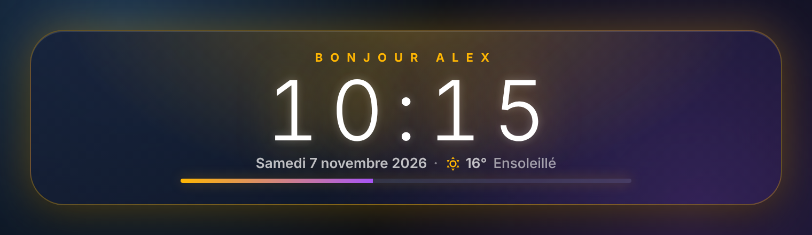

# OhMyHA Clock

A glowing clock tile for your Home Assistant dashboard: a greeting that follows the time of day, a big thin clock, the date, the current weather and a day progress bar. Warm amber by day, cyan by night.





## Features

- Greeting by time of day, with your name or the logged-in user's first name
- Big thin clock, 24h or 12h (follows your Home Assistant settings), optional seconds
- Full date in your language (French, English, German, Spanish, Italian, Dutch, Portuguese greetings; the date works in any language)
- Optional weather: icon, temperature and condition from any `weather.*` entity
- Day progress bar from midnight to midnight
- Day and night colours you can change, switch hours you can change
- Visual editor, no other card or dependency needed, one small file

## Installation

<!-- ha-marketplace:exclude-start -->
**Before it is listed in the Marketplace**, add it as a custom repository:

[](https://my.home-assistant.io/redirect/hacs_repository/?owner=OhMyHAdash&repository=ohmyha-clock-card&category=plugin)

Or in **Settings > Marketplace** (HACS on older versions): menu ⋮ > *Custom repositories*, paste `https://github.com/OhMyHAdash/ohmyha-clock-card`, type *Dashboard*, then install **OhMyHA Clock**.

**Manual install:** copy `dist/ohmyha-clock-card.js` to `config/www/`, then add the resource `/local/ohmyha-clock-card.js` (JavaScript module) in *Settings > Dashboards > ⋮ > Resources*.
<!-- ha-marketplace:exclude-end -->

Then edit a dashboard, *Add card* and search for **OhMyHA Clock**.

## Configuration

```yaml
type: custom:ohmyha-clock-card
weather: weather.home
show_user_name: true
```

| Option | Default | Description |
| --- | --- | --- |
| `name` | | Name shown after the greeting (`Good evening Alex`) |
| `show_user_name` | `false` | Use the first name of the logged-in user when `name` is empty |
| `weather` | | A `weather.*` entity to show the temperature and condition |
| `show_seconds` | `false` | Show seconds |
| `show_bar` | `true` | Show the day progress bar |
| `time_format` | auto | `24` or `12` (auto follows your profile) |
| `language` | auto | Language of the greeting and date (`fr`, `en`, `de`...) |
| `day_color` | `#ffb703` | Accent colour by day (hex, `r,g,b` or `[r, g, b]`) |
| `night_color` | `#00f2fe` | Accent colour by night |
| `second_color` | `#a855f7` | Colour at the end of the progress bar |
| `day_start` | `6` | Hour when the day colour starts |
| `night_start` | `18` | Hour when the night colour starts |
| `height` | `165` | Card height in pixels |
| `clock_weight` | `300` | Clock thickness: `100` thin to `400` regular |



## Want the whole dashboard in this style?

This clock is the top tile of the **OhMyHA** dashboards: 6 designs, 37 cards, any colour, ready in about ten minutes from a visual configurator. Try it free at **[ohmyha.com](https://ohmyha.com/?ref=carte)**.

## Licence

MIT. Made in France by [OhMyHA](https://ohmyha.com/?ref=carte).
